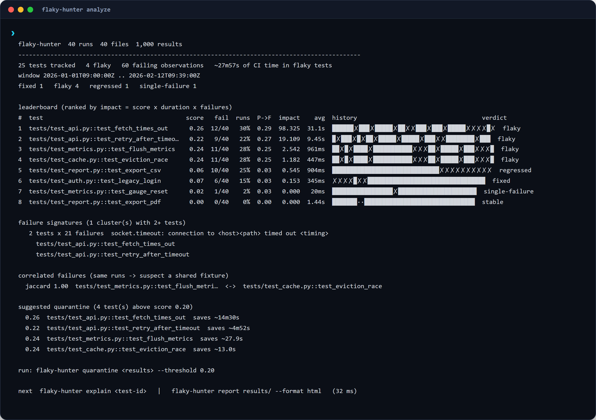
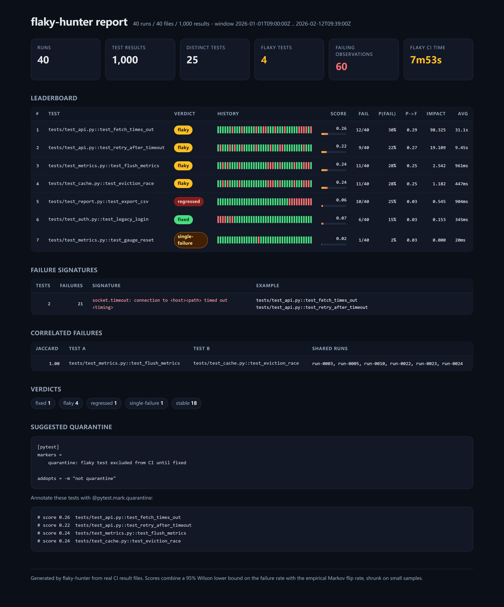
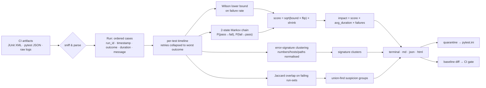

# flaky-hunter

**Rerun your CI twice and it tells you which tests are lying to you: a ranked,
statistically defensible list of flaky tests, the error signature they share, and
a `pytest.ini` that quarantines them today.**

[](https://github.com/kele-tao/flaky-hunter/actions/workflows/ci.yml)




## The problem

A flaky test costs far more than the ten seconds it takes to fail. It costs the
rerun, the twelve minutes of a full suite that rerun drags with it, the engineer
who now distrusts the red X, and eventually the team that starts merging past
failures. Most teams know they *have* flakes; almost none can name them.

The usual workaround is `pytest --rerun-failed` or a spreadsheet. Both hide the
problem: a rerun turns a real regression into a pass, and a spreadsheet has no
memory of *how often* and *when* each test fails. CI systems show you the last run,
which is exactly the run that carries the least information.

flaky-hunter reads the history you already upload, does the statistics properly,
and answers the only question that matters: **which tests should we stop running,
and what is the shared cause?**

## What it does

- **Reads what your CI already produces.** JUnit XML (pytest, jest-junit,
  go-junit-report, maven surefire), pytest-json-report JSON, generic JSON arrays,
  and a line-oriented fallback parser for raw logs (`pytest -v`, `go test -v`,
  surefire text). A directory of 200 result files is one argument.
- **Scores flakiness with uncertainty attached.** A 95% Wilson lower bound on the
  failure rate multiplied by the empirical Markov flip rate, then shrunk towards
  zero on small samples. A test that always fails scores 0 (it is broken, not
  flaky); a test seen twice cannot outrank a test seen 40 times.
- **Ranks by cost.** `impact = score x average duration x failures`, so a 31-second
  timeout outranks a 20 ms assertion that flakes just as often.
- **Clusters failures by signature.** Numbers, host:port pairs, paths, UUIDs and
  timings are normalised away, so 14 tests failing on the same database timeout
  collapse into one line you can act on.
- **Finds correlated failures.** Two tests that fail in the same runs are one
  shared fixture, not two flakes; Jaccard overlap plus union-find groups them.
- **Produces four reports.** Terminal leaderboard, Markdown, JSON (the machine
  contract) and a self-contained HTML file with inline SVG sparklines — no CDN,
  no JavaScript build step, opens offline.
- **Generates the fix.** `flaky-hunter quarantine` writes or merges a `pytest.ini`
  with a `quarantine` marker and `addopts = -m "not quarantine"`, and prints the
  exact `@pytest.mark.quarantine` annotations to paste above each test.
- **Diffs against a baseline.** `--baseline baseline.json` reports newly flaky,
  worsened and *fixed* tests; `--fail-on-new` turns that into a CI gate.
- **Explains itself.** `flaky-hunter explain <test>` prints the history, the
  arithmetic and the correlated tests that probably share its root cause.

Zero runtime dependencies. Python 3.10+. No network calls, ever.

## Install

Not on PyPI yet — install from source:

```bash
git clone https://github.com/kele-tao/flaky-hunter
cd flaky-hunter
pip install -e .
```

Then either `flaky-hunter --help` or `python -m flaky_hunter --help`.

## Usage

### 1. Rank the flakes in a directory of CI results

```console
$ python -m flaky_hunter analyze examples/results
  flaky-hunter  40 runs  40 files  1,000 results
  ------------------------------------------------------------------------------------------------
  25 tests tracked   4 flaky   60 failing observations   ~27m57s of CI time in flaky tests
  window 2026-01-01T09:00:00Z .. 2026-02-12T09:39:00Z
  fixed 1   flaky 4   regressed 1   single-failure 1

  leaderboard (ranked by impact = score x duration x failures)
  #  test                                        score   fail  runs  P->F  impact    avg  history                                   verdict
  1  tests/test_api.py::test_fetch_times_out      0.26  12/40   30%  0.29  98.325  31.1s  ██████✗███✗█████✗██✗✗███✗███✗█████✗✗✗✗█✗  flaky
  2  tests/test_api.py::test_retry_after_timeo…   0.22   9/40   22%  0.27  19.109  9.45s  █✗███✗█✗██✗█████✗█████✗███✗✗████████✗███  flaky
  3  tests/test_metrics.py::test_flush_metrics    0.24  11/40   28%  0.25   2.542  961ms  ██✗█✗████✗███████████✗✗✗██✗█████✗███✗✗✗█  flaky
  4  tests/test_cache.py::test_eviction_race      0.24  11/40   28%  0.25   1.182  447ms  ██✗█✗████✗███████████✗✗✗██✗█████✗███✗✗✗█  flaky
  5  tests/test_report.py::test_export_csv        0.06  10/40   25%  0.03   0.545  904ms  ██████████████████████████████✗✗✗✗✗✗✗✗✗✗  regressed
  6  tests/test_auth.py::test_legacy_login        0.07   6/40   15%  0.03   0.153  345ms  ✗✗✗✗█✗✗█████████████████████████████████  fixed
  7  tests/test_metrics.py::test_gauge_reset      0.02   1/40    2%  0.03   0.000   20ms  █████████████████✗██████████████████████  single-failure
  8  tests/test_report.py::test_export_pdf        0.00   0/40    0%  0.00   0.000  1.44s  ███████··███████████████████████████████  stable

  failure signatures (1 cluster(s) with 2+ tests)
     2 tests x 21 failures  socket.timeout: connection to <host><path> timed out <timing>
       tests/test_api.py::test_fetch_times_out
       tests/test_api.py::test_retry_after_timeout

  correlated failures (same runs -> suspect a shared fixture)
    jaccard 1.00  tests/test_metrics.py::test_flush_metri…  <->  tests/test_cache.py::test_eviction_race

  suggested quarantine (4 test(s) above score 0.20)
    0.26  tests/test_api.py::test_fetch_times_out  saves ~14m30s
    0.22  tests/test_api.py::test_retry_after_timeout  saves ~4m52s
    0.24  tests/test_metrics.py::test_flush_metrics  saves ~27.9s
    0.24  tests/test_cache.py::test_eviction_race  saves ~13.0s

  run: flaky-hunter quarantine <results> --threshold 0.20

  next  flaky-hunter explain <test-id>   |   flaky-hunter report results/ --format html
```

Every test on screen is one of 25 in a seeded synthetic corpus
(`benchmarks/gen_results.py`), and every number above is computed from those 40
JUnit files. Re-running the same command on the same files produces byte-identical
output.

### 2. Ask why one test got its verdict

```console
$ python -m flaky_hunter explain tests/test_api.py::test_fetch_times_out --results examples/results
  tests/test_api.py::test_fetch_times_out
  verdict FLAKY   score 0.264   impact 98.325   runs 40 (28 pass / 12 fail / 0 skip)

  history
    oldest ██████✗███✗█████✗██✗✗███✗███✗█████✗✗✗✗█✗ newest
                 ^   ^     ^  ^^   ^   ^     ^^^^ ^

  evidence
    failure rate            30.0%  (12/40 decided runs)
    wilson 95% lower bound  0.181   [#####-----------------------]
    markov  P(pass -> fail) 0.286
    markov  P(fail -> pass) 0.636
    flip ratio              0.385   (15 flips over 39 transitions)
    flakiness score         0.264   sqrt(bound x flip) x shrink
    average duration        31.1s
    impact                  98.325   score x duration x failures

  failure messages (most recent first)
    run 39 socket.timeout: connection to api.internal:8443/v2/items timed out after 30.0s
    run 37 socket.timeout: connection to api.internal:8443/v2/items timed out after 30.0s
    run 36 socket.timeout: connection to api.internal:8443/v2/items timed out after 30.0s
```

### 3. Quarantine the offenders

```console
$ python -m flaky_hunter quarantine examples/results --out pytest.ini
  quarantine threshold 0.20
  4 test(s) selected, 43 failing observations avoided
    0.26  tests/test_api.py::test_fetch_times_out
    0.24  tests/test_cache.py::test_eviction_race
    0.24  tests/test_metrics.py::test_flush_metrics
    0.22  tests/test_api.py::test_retry_after_timeout

  created pytest.ini
```

The file it writes (merging into an existing `pytest.ini` instead of clobbering it
if one is already there):

```ini
# Generated by flaky-hunter. Regenerate with: flaky-hunter quarantine <results>
[pytest]
markers =
    quarantine: flaky test excluded from CI until it is fixed
addopts = -m "not quarantine"

; quarantined by flaky-hunter (score >= 0.20)
;   0.26  tests/test_api.py::test_fetch_times_out
;   0.24  tests/test_cache.py::test_eviction_race
;   0.24  tests/test_metrics.py::test_flush_metrics
;   0.22  tests/test_api.py::test_retry_after_timeout
```

The merge is idempotent and refuses to edit a config file whose only section is
`[tool.black]`-style, rather than silently corrupting it.

### Reports

```bash
flaky-hunter report results/ --format md   -o report.md     # GitHub comment
flaky-hunter report results/ --format json -o report.json   # machine contract
flaky-hunter report results/ --html        -o report.html   # self-contained page
flaky-hunter report results/ --format terminal              # same as analyze
```

The HTML report is one file with no external requests: inline CSS, inline SVG
sparklines (one bar per run, red for failure), and the quarantine snippet ready to
copy. The committed screenshot at [docs/report.png](docs/report.png) is that file,
rendered by a headless browser:



### Supported inputs

| Format | Produced by | What is read |
| --- | --- | --- |
| JUnit XML | pytest, jest-junit, go-junit-report, maven surefire | testcase name/classname/file, time, failure/error/skipped + message |
| pytest JSON | `pytest --json-report` | nodeid, outcome, duration, call longrepr |
| Generic JSON | any exporter emitting a list of `{name, status}` | name, status/outcome, duration, message |
| Raw log | `pytest -v`, `go test -v`, surefire console output | `[gw0] [ 42%] FAILED path::test - message`, `--- FAIL: TestX`, `[ERROR] test(Class)` |

`examples/raw-log/` is the same 25-test suite as `examples/results/`, exported as
ten raw `pytest -v` logs instead of JUnit XML. The transcript below shows the
fallback parser reading it — durations are `n/a` there, because a log line does
not carry one, and the tool says so instead of inventing a number.

```console
$ python -m flaky_hunter analyze examples/raw-log
  flaky-hunter  10 runs  10 files  250 results
  ------------------------------------------------------------------------------------------------
  25 tests tracked   2 flaky   17 failing observations   ~0ms of CI time in flaky tests
  fixed 1   flaky 2   single-failure 2

  leaderboard (ranked by impact = score x duration x failures)
  #  test                                        score   fail  runs  P->F  impact    avg  history     verdict
  1  tests/test_api.py::test_retry_after_timeo…   0.32   6/10   60%  0.50   1.937    n/a  ██✗✗✗██✗✗✗  flaky
  2  tests/test_auth.py::test_legacy_login        0.32   6/10   60%  0.33   1.937    n/a  ✗✗✗✗█✗✗███  fixed
  3  tests/test_api.py::test_fetch_times_out      0.27   3/10   30%  0.50   0.804    n/a  █✗███✗█✗██  flaky
  4  tests/test_cache.py::test_eviction_race      0.06   1/10   10%  0.12   0.063    n/a  ██✗███████  single-failure
```

### Baseline gate in CI

```bash
# once, on a good week:
flaky-hunter baseline results/ --out baseline.json

# every night:
flaky-hunter analyze results/ --baseline baseline.json --fail-on-new
```

`examples/baseline.json` was produced from the first 20 runs of the example corpus
with `flaky-hunter baseline`; diffing the full 40 runs against it reports two
tests as *worsened*, because the second half of the corpus is noisier.

### Exit codes

| Code | Meaning |
| ---: | --- |
| 0 | No test reached the flakiness threshold |
| 1 | At least one flaky test found (or `--fail-on-new` triggered) |
| 2 | Usage error, missing file, or unparseable input — one line on stderr, no traceback |

## How it works



**Parsing.** Every input becomes `Run` objects holding `TestCase` observations with
a canonical outcome (`pass`, `fail`, `error`, `skip`), a duration and a message.
Runs are ordered by timestamp then id, so no statistic depends on the order the
filesystem handed us files. Two files with the same run id (a re-uploaded
artifact) are deduplicated. Repeated observations of a test inside one run are
collapsed to the worst outcome — a retried test that eventually passed did *not*
pass on the first try, and that is the signal.

**Scoring.** Two independent things make a test flaky: it fails often, and it
*alternates*. The first is estimated with a 95% Wilson lower bound, which shrinks
towards zero when the sample is small. The second is the flip ratio from a
two-state Markov chain fitted to the pass/fail sequence. The score is the
geometric mean of the two, times a shrink factor that ramps from 0 to 1 over the
first five observations:

```text
score = sqrt(failure_lower_bound × flip_ratio) × min(1, runs / 5)
```

The geometric mean is the important part. A test that fails every time scores 0 —
it is broken, and calling it flaky is how broken tests escape. A test that fails
once in 40 runs also scores near 0: one failure is a coincidence, not a pattern.
Only a test that does both — fails *and* recovers — scores high.

**Explaining the rest.** Passing tests are irrelevant; failing tests that always
fail are a regression report, not a flake report. So `classify` looks at the head
and tail of the history as well as the score, which is where the `regressed` and
`fixed` verdicts come from. Separately, failure messages are normalised
(numbers, `host:port`, paths, UUIDs, timings) and clustered, and Jaccard overlap
between failing run-sets exposes tests that fail *together*.

### Precision and recall, honestly measured

`examples/ground_truth.json` labels every one of the 25 synthetic tests.
`python benchmarks/evaluate.py` compares the tool's output with those labels:

```text
$ python benchmarks/evaluate.py
corpus: 40 runs x 25 tests, threshold 0.2
flagged 4  precision 0.75  recall 1.00  false positives 1
  true positive   tests/test_api.py::test_fetch_times_out
  true positive   tests/test_api.py::test_retry_after_timeout
  true positive   tests/test_cache.py::test_eviction_race
  false positive  tests/test_metrics.py::test_flush_metrics
  top 4 by impact:
    1. tests/test_api.py::test_fetch_times_out
    2. tests/test_api.py::test_retry_after_timeout
    3. tests/test_metrics.py::test_flush_metrics
    4. tests/test_cache.py::test_eviction_race
  threshold sweep:
    0.10  flagged 4  precision 0.75  recall 1.00
    0.15  flagged 4  precision 0.75  recall 1.00
    0.20  flagged 4  precision 0.75  recall 1.00
    0.25  flagged 1  precision 1.00  recall 0.33
    0.30  flagged 0  precision 0.00  recall 0.00
  the false positive fails in exactly the same runs as a true flake:
    jaccard 1.00 over 11 shared runs
    tests/test_metrics.py::test_flush_metrics
    tests/test_cache.py::test_eviction_race
```

All three genuinely flaky tests rank in the **top four by impact**, and there is
exactly **one false positive**. That false positive is the interesting part:
`test_flush_metrics` fails in precisely the runs where `test_eviction_race`
fails (Jaccard **1.00**, 11 shared runs). It is a symptom of the cache outage, not
an independent flake, and per-test statistics alone cannot tell the difference.
The correlated-failure section names the pair and the shared runs, which is what
turns a wrong entry in the quarantine list into a diagnosis.

The threshold sweep printed by the same script is equally honest: at 0.25 the tool
keeps precision 1.00 but recall drops to 0.33; at 0.10–0.20 it stays at 0.75/1.00.
The default is 0.20 for that reason, and `--threshold` is documented rather than
hidden.

## Design decisions

**1. Confidence bounds instead of raw failure rates.** A raw rate makes a test
that failed twice in two runs (1.0) look worse than one that failed 18 times in 40
(0.45). The Wilson lower bound says the first is *at least* 0.34 and the second at
least 0.31, which is closer to the truth than either raw number. The cost: the
score is not a probability and cannot be read as "35% chance of failing". It is
documented in `explain` as a ranking signal, and the printed evidence includes the
raw rate next to it so nobody has to trust one number.

**2. A geometric mean, so "always failing" scores zero.** The alternative —
counting failures and ranking by count — floods the top of the leaderboard with
broken tests, which is precisely the noise teams already ignore. Multiplying by
the flip rate means the tool answers "what is intermittently wrong", and the
`broken`/`regressed` verdicts carry the other answer without polluting the
flaky list. The cost: a test that fails 90% of the time is *less* flaky by this
metric than one that fails 50% of the time. That is deliberate — the 90% test will
be caught by ordinary CI, the 50% test never will.

**3. Pure standard library, offline, single file of HTML.** No HTTP client means
no credentials in CI, no rate limits and no flaky tests in the flaky-test tool. The
HTML report has no CDN imports and no JS framework, so it opens from an artifact
zip on a plane. The cost: no interactive filtering, no drill-down, no live
dashboards. `--format json` is the escape hatch for anyone who wants to build
those.

## Performance

Produced by `python benchmarks/run.py` (Windows 11, Python 3.12.10, one laptop
core; the full table and raw JSON are in [benchmarks/RESULTS.md](benchmarks/RESULTS.md)
and [benchmarks/results.json](benchmarks/results.json)):

| corpus | runs | results | tests | analyse (s) | results/s |
| --- | ---: | ---: | ---: | ---: | ---: |
| example-40x25 | 40 | 1,000 | 25 | 0.03 | 30,952 |
| medium-200x25 | 200 | 5,000 | 25 | 0.19 | 26,289 |
| large-1000x25 | 1,000 | 25,000 | 25 | 0.88 | 28,559 |

| raw CI log fallback | file (MB) | tests | analyse (s) | results/s |
| ---: | ---: | ---: | ---: | ---: |
| 50,000 result lines | 2.6 | 120 | 0.67 | 74,177 |
| 100,000 result lines | 5.2 | 120 | 1.31 | 76,111 |

100,000 parsed test results in 1.31 s, including reading a 5.2 MB log from disk,
scoring, signature clustering and correlation detection. The scoring pass is
O(results) with a per-test sort by run index; correlation detection only compares
tests that failed at least twice, so it never becomes quadratic on a healthy suite.

## Comparison

| | flaky-hunter | pytest-rerunfailures | BuildPulse / Datadog CI Visibility |
| --- | --- | --- | --- |
| Cost | free, offline | free, offline | paid SaaS |
| What it answers | which tests are flaky, by how much, and what they share | "this run went green" | which tests are flaky, with a dashboard |
| Reruns tests | no (by design) | **yes** | no |
| Statistical model | Wilson bound × Markov flip rate, documented | none | proprietary |
| Works on historical artifacts | **yes** | no, only the current run | yes, if you upload |
| Correlated-failure detection | yes (Jaccard + union-find) | no | partial |
| Quarantine config generation | **yes** | no | manual |
| Interactive UI | no | no | **yes** |
| Multi-language results | JUnit XML + pytest JSON + logs | pytest only | broad, via agents |

**pytest-rerunfailures is better** if what you want is a green build in ten
minutes: it retries and moves on. flaky-hunter is for the following week, when you
want the retries to stop. **BuildPulse and Datadog are better** at org-wide
dashboards, historical trends across hundreds of repos and alerting; they cost
money and require an agent. **Nothing here is a replacement for either** — it is
the smallest thing that produces a defensible quarantine list from the artifacts
you already have.

## Roadmap

- Duration-aware flakiness: a test that passes slowly and fails when it crosses a
  timeout is flaky for a *reason*; today duration only feeds the impact ranking.
- Signature-aware quarantine: quarantine the cluster (one bug) instead of 14
  independently listed tests.
- A compact, diffable baseline format so baseline changes are reviewable in a
  pull request.
- `--format sarif` so findings show up in GitHub's code scanning UI.
- `flaky-hunter tune` to pick a threshold from a team's own history, exposing the
  sweep that `benchmarks/evaluate.py` already prints.

What was deliberately left out of 1.0 — automatic bisection, live CI APIs, rerun
orchestration, ML classification — is documented with reasons in
[docs/ROADMAP.md](docs/ROADMAP.md).

## Quality

Every number in this section is measured, not estimated:

| check | command | result |
| --- | --- | --- |
| tests | `pytest -q` | 166 passing, no network, no sleeps |
| coverage | `pytest --cov=flaky_hunter --cov-branch` | 92% line+branch over `src/flaky_hunter` |
| lint | `ruff check . && ruff format --check .` | clean at line length 100 |
| CI | GitHub Actions | Python 3.10, 3.11 and 3.12, all green |

The suite covers every parser (happy path, malformed, empty, unicode CJK + emoji, 2,000-result
smoke test), the scoring maths against hand-computed values, the report renderers
(including HTML escaping of untrusted test names), quarantine merge semantics against a
pre-existing `pytest.ini`, baseline diffing, and the CLI exit codes 0/1/2.


## Contributing

Issues and pull requests are welcome. The rules are short: `ruff check .`,
`ruff format --check .` and `pytest -q` must pass, new parsers need a fixture built
from a real tool's output, and statistical changes need a test that states the
expected number. Full details in [CONTRIBUTING.md](CONTRIBUTING.md).

## License

MIT — see [LICENSE](LICENSE). Copyright (c) 2026 kele.
