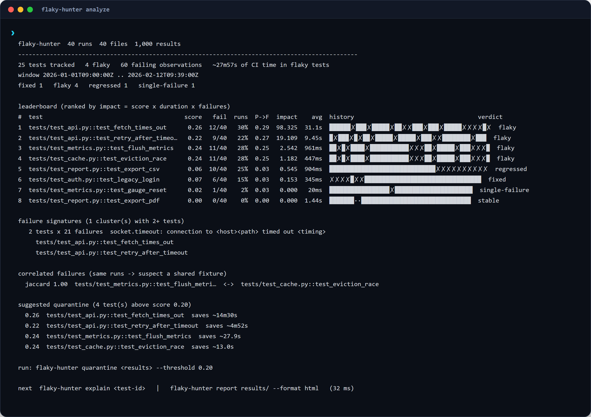
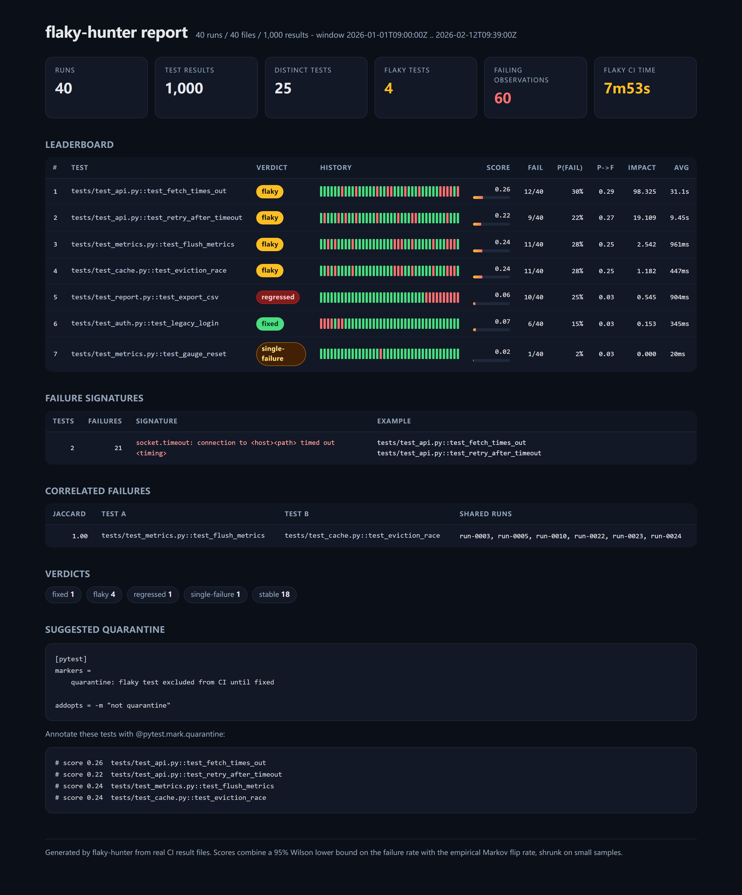
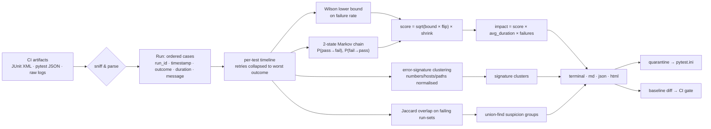

# flaky-hunter

[English](README.md) | **简体中文**

**把你的 CI 再跑一次，它就会告诉你哪些测试在骗你：一份排好序、统计上站得住脚的不稳定测试（flaky test）清单，这些测试共享的错误签名，以及一份今天就能把它们隔离起来的 `pytest.ini`。**

[](https://github.com/kele-tao/flaky-hunter/actions/workflows/ci.yml)




## 问题

一条不稳定测试的代价，远不止它失败那十秒。代价还包括那次重跑，重跑所拖动的整套测试那十二分钟，那个从此不再相信红色叉号的工程师，以及最终开始带着失败合并代码的团队。大多数团队都知道自己*有* flake，却几乎没人能说出是哪几条。

常见的变通做法是 `pytest --rerun-failed` 或者一张表格。两者都在掩盖问题：重跑会把一次真实的回归变成通过，而表格记不住每条测试失败得*多频繁*、在*什么时候*失败。CI 系统只给你看最近一次运行，而恰恰是这次运行携带的信息最少。

flaky-hunter 读取你本来就在上传的历史数据，把统计做对，然后回答唯一重要的问题：**哪些测试应该停止运行，它们共同的成因是什么？**

## 它能做什么

- **读取 CI 已经在产出的东西。** JUnit XML（pytest、jest-junit、go-junit-report、maven surefire）、pytest-json-report 的 JSON、通用 JSON 数组，以及一个面向行的兜底解析器，用来处理原始日志（`pytest -v`、`go test -v`、surefire 文本输出）。200 个结果文件组成的目录，只是一个参数。
- **打分时带上不确定性。** 对失败率取 95% Wilson 下界，再乘以经验马尔可夫翻转率（Markov flip rate），最后在小样本上向零收缩。一条总是失败的测试得分为 0（它是坏的，不是不稳定的）；一条只被观测到两次的测试，不可能排到一条被观测到 40 次的测试前面。
- **按代价排序。** `impact = score x average duration x failures`，所以一次 31 秒的超时，会排在一条 20 毫秒、抖动频率相同的断言之前。
- **按签名聚类失败。** 数字、host:port 对、路径、UUID 和耗时都被归一化抹掉，于是 14 条因为同一个数据库超时而失败的测试会收敛成一行，你可以直接据此行动。
- **找出相关失败。** 在同一批运行里一起失败的两条测试，背后是一个共享 fixture，而不是两个 flake；Jaccard 重叠度加上并查集（union-find）把它们归到一组。
- **产出四份报告。** 终端排行榜、Markdown、JSON（机器可读的契约），以及一个自包含的 HTML 文件，内置内联 SVG 迷你走势图（sparklines）——不依赖 CDN、没有 JavaScript 构建步骤、离线可打开。
- **生成修复方案。** `flaky-hunter quarantine` 会写出或合并一份 `pytest.ini`，其中包含 `quarantine` marker 和 `addopts = -m "not quarantine"`，并打印出需要粘贴到每条测试上方的 `@pytest.mark.quarantine` 注解。
- **与基线做差异。** `--baseline baseline.json` 报告新出现的不稳定、恶化的以及*已修复*的测试；`--fail-on-new` 把它变成一个 CI 门禁。
- **能自我解释。** `flaky-hunter explain <test>` 会打印历史、算式，以及很可能与它同根因的相关测试。

零运行时依赖。Python 3.10+。任何情况下都不发起网络请求。

## 安装

还没有发布到 PyPI —— 从源码安装：

```bash
git clone https://github.com/kele-tao/flaky-hunter
cd flaky-hunter
pip install -e .
```

安装完成后，用 `flaky-hunter --help` 或 `python -m flaky_hunter --help` 都可以。

## 用法

### 1. 对一份 CI 结果目录里的不稳定测试排名

```console
$ python -m flaky_hunter analyze examples/results
  flaky-hunter  40 runs  40 files  1,000 results
  ------------------------------------------------------------------------------------------------
  25 tests tracked   4 flaky   60 failing observations   ~27m57s of CI time in flaky tests
  window 2026-01-01T09:00:00Z .. 2026-02-12T09:39:00Z
  fixed 1   flaky 4   regressed 1   single-failure 1

  leaderboard (ranked by impact = score x duration x failures)
  #  test                                        score   fail  runs  P->F  impact    avg  history                                   verdict
  1  tests/test_api.py::test_fetch_times_out      0.26  12/40   30%  0.29  98.325  31.1s  ██████✗███✗█████✗██✗✗███✗███✗█████✗✗✗✗█✗  flaky
  2  tests/test_api.py::test_retry_after_timeo…   0.22   9/40   22%  0.27  19.109  9.45s  █✗███✗█✗██✗█████✗█████✗███✗✗████████✗███  flaky
  3  tests/test_metrics.py::test_flush_metrics    0.24  11/40   28%  0.25   2.542  961ms  ██✗█✗████✗███████████✗✗✗██✗█████✗███✗✗✗█  flaky
  4  tests/test_cache.py::test_eviction_race      0.24  11/40   28%  0.25   1.182  447ms  ██✗█✗████✗███████████✗✗✗██✗█████✗███✗✗✗█  flaky
  5  tests/test_report.py::test_export_csv        0.06  10/40   25%  0.03   0.545  904ms  ██████████████████████████████✗✗✗✗✗✗✗✗✗✗  regressed
  6  tests/test_auth.py::test_legacy_login        0.07   6/40   15%  0.03   0.153  345ms  ✗✗✗✗█✗✗█████████████████████████████████  fixed
  7  tests/test_metrics.py::test_gauge_reset      0.02   1/40    2%  0.03   0.000   20ms  █████████████████✗██████████████████████  single-failure
  8  tests/test_report.py::test_export_pdf        0.00   0/40    0%  0.00   0.000  1.44s  ███████··███████████████████████████████  stable

  failure signatures (1 cluster(s) with 2+ tests)
     2 tests x 21 failures  socket.timeout: connection to <host><path> timed out <timing>
       tests/test_api.py::test_fetch_times_out
       tests/test_api.py::test_retry_after_timeout

  correlated failures (same runs -> suspect a shared fixture)
    jaccard 1.00  tests/test_metrics.py::test_flush_metri…  <->  tests/test_cache.py::test_eviction_race

  suggested quarantine (4 test(s) above score 0.20)
    0.26  tests/test_api.py::test_fetch_times_out  saves ~14m30s
    0.22  tests/test_api.py::test_retry_after_timeout  saves ~4m52s
    0.24  tests/test_metrics.py::test_flush_metrics  saves ~27.9s
    0.24  tests/test_cache.py::test_eviction_race  saves ~13.0s

  run: flaky-hunter quarantine <results> --threshold 0.20

  next  flaky-hunter explain <test-id>   |   flaky-hunter report results/ --format html
```

屏幕上每一条测试，都是带种子的合成语料（`benchmarks/gen_results.py`）中 25 条里的一条，上面每一个数字都由那 40 份 JUnit 文件计算得出。对同一批文件重跑同一条命令，输出逐字节一致。

### 2. 追问某条测试为什么得到这个判定

```console
$ python -m flaky_hunter explain tests/test_api.py::test_fetch_times_out --results examples/results
  tests/test_api.py::test_fetch_times_out
  verdict FLAKY   score 0.264   impact 98.325   runs 40 (28 pass / 12 fail / 0 skip)

  history
    oldest ██████✗███✗█████✗██✗✗███✗███✗█████✗✗✗✗█✗ newest
                 ^   ^     ^  ^^   ^   ^     ^^^^ ^

  evidence
    failure rate            30.0%  (12/40 decided runs)
    wilson 95% lower bound  0.181   [#####-----------------------]
    markov  P(pass -> fail) 0.286
    markov  P(fail -> pass) 0.636
    flip ratio              0.385   (15 flips over 39 transitions)
    flakiness score         0.264   sqrt(bound x flip) x shrink
    average duration        31.1s
    impact                  98.325   score x duration x failures

  failure messages (most recent first)
    run 39 socket.timeout: connection to api.internal:8443/v2/items timed out after 30.0s
    run 37 socket.timeout: connection to api.internal:8443/v2/items timed out after 30.0s
    run 36 socket.timeout: connection to api.internal:8443/v2/items timed out after 30.0s
```

### 3. 隔离肇事测试

```console
$ python -m flaky_hunter quarantine examples/results --out pytest.ini
  quarantine threshold 0.20
  4 test(s) selected, 43 failing observations avoided
    0.26  tests/test_api.py::test_fetch_times_out
    0.24  tests/test_cache.py::test_eviction_race
    0.24  tests/test_metrics.py::test_flush_metrics
    0.22  tests/test_api.py::test_retry_after_timeout

  created pytest.ini
```

它写出的文件如下（如果目录里已经有 `pytest.ini`，会合并进去而不是覆盖）：

```ini
# Generated by flaky-hunter. Regenerate with: flaky-hunter quarantine <results>
[pytest]
markers =
    quarantine: flaky test excluded from CI until it is fixed
addopts = -m "not quarantine"

; quarantined by flaky-hunter (score >= 0.20)
;   0.26  tests/test_api.py::test_fetch_times_out
;   0.24  tests/test_cache.py::test_eviction_race
;   0.24  tests/test_metrics.py::test_flush_metrics
;   0.22  tests/test_api.py::test_retry_after_timeout
```

这次合并是幂等的，并且当配置文件的唯一段落是 `[tool.black]` 这类内容时会拒绝编辑，而不是悄悄把它弄坏。

### 报告

```bash
flaky-hunter report results/ --format md   -o report.md     # GitHub comment
flaky-hunter report results/ --format json -o report.json   # machine contract
flaky-hunter report results/ --html        -o report.html   # self-contained page
flaky-hunter report results/ --format terminal              # same as analyze
```

HTML 报告是单个文件，不发起任何外部请求：内联 CSS、内联 SVG 迷你走势图（每次运行一根竖条，失败为红色），以及可直接复制的隔离片段。提交进仓库的截图 [docs/report.png](docs/report.png) 就是那个文件由无头浏览器渲染出来的结果：



### 支持的输入

| 格式 | 产出方 | 读取的内容 |
| --- | --- | --- |
| JUnit XML | pytest、jest-junit、go-junit-report、maven surefire | testcase 的 name/classname/file、time、failure/error/skipped 以及 message |
| pytest JSON | `pytest --json-report` | nodeid、outcome、duration、call longrepr |
| 通用 JSON | 任何导出 `{name, status}` 列表的导出器 | name、status/outcome、duration、message |
| 原始日志 | `pytest -v`、`go test -v`、surefire 控制台输出 | `[gw0] [ 42%] FAILED path::test - message`、`--- FAIL: TestX`、`[ERROR] test(Class)` |

`examples/raw-log/` 与 `examples/results/` 是同一套 25 条测试，只不过导出成十份原始 `pytest -v` 日志，而不是 JUnit XML。下面的终端记录展示了兜底解析器读取它的过程——在那里耗时会显示为 `n/a`，因为一行日志本身不携带耗时，工具会如实说明这一点，而不是凭空编一个数字。

```console
$ python -m flaky_hunter analyze examples/raw-log
  flaky-hunter  10 runs  10 files  250 results
  ------------------------------------------------------------------------------------------------
  25 tests tracked   2 flaky   17 failing observations   ~0ms of CI time in flaky tests
  fixed 1   flaky 2   single-failure 2

  leaderboard (ranked by impact = score x duration x failures)
  #  test                                        score   fail  runs  P->F  impact    avg  history     verdict
  1  tests/test_api.py::test_retry_after_timeo…   0.32   6/10   60%  0.50   1.937    n/a  ██✗✗✗██✗✗✗  flaky
  2  tests/test_auth.py::test_legacy_login        0.32   6/10   60%  0.33   1.937    n/a  ✗✗✗✗█✗✗███  fixed
  3  tests/test_api.py::test_fetch_times_out      0.27   3/10   30%  0.50   0.804    n/a  █✗███✗█✗██  flaky
  4  tests/test_cache.py::test_eviction_race      0.06   1/10   10%  0.12   0.063    n/a  ██✗███████  single-failure
```

### CI 中的基线门禁

```bash
# once, on a good week:
flaky-hunter baseline results/ --out baseline.json

# every night:
flaky-hunter analyze results/ --baseline baseline.json --fail-on-new
```

`examples/baseline.json` 是用 `flaky-hunter baseline` 从示例语料的前 20 次运行生成的；拿全部 40 次运行与它做差异，会把两条测试报告为*恶化*，因为语料的后半部分噪声更大。

### 退出码

| 代码 | 含义 |
| ---: | --- |
| 0 | 没有测试达到不稳定阈值 |
| 1 | 至少发现一条不稳定测试（或 `--fail-on-new` 被触发） |
| 2 | 用法错误、文件缺失或输入无法解析 —— stderr 上输出一行，不打 traceback |

## 工作原理



**解析。** 每一种输入都会变成 `Run` 对象，其中持有 `TestCase` 观测：一个规范化后的结果（`pass`、`fail`、`error`、`skip`）、一个耗时和一条 message。运行按时间戳、再按 id 排序，因此没有任何统计量依赖于文件系统把文件交给我们的顺序。运行 id 相同的两个文件（重复上传的 artifact）会被去重。同一次运行内对一条测试的重复观测会折叠成最差的结果——一条重试之后最终通过的测试，第一次尝试并没有通过，而那正是信号所在。

**打分。** 让一条测试变得不稳定的是两件相互独立的事：它经常失败，并且它会*来回翻转*。前者用 95% Wilson 下界估计，样本小时会向零收缩。后者是拟合在 pass/fail 序列上的两状态马尔可夫链给出的翻转率。得分是两者的几何平均，再乘以一个在前五次观测中从 0 爬到 1 的收缩因子：

```text
score = sqrt(failure_lower_bound × flip_ratio) × min(1, runs / 5)
```

几何平均是关键的那一部分。一条每次都失败的测试得分为 0——它是坏的，而把它叫作不稳定，正是坏测试得以逃脱的方式。一条 40 次运行里失败一次的测试，得分同样接近 0：一次失败是巧合，不是模式。只有同时做到两件事——既失败*又*恢复——的测试才会得到高分。

**解释其余部分。** 通过的测试无关紧要；总是失败的测试是一份回归报告，而不是 flake 报告。所以 `classify` 除了得分之外，还会看历史的首部和尾部，`regressed` 和 `fixed` 这两个判定就是这样来的。另外，失败信息会被归一化（数字、`host:port`、路径、UUID、耗时）并聚类，失败运行集合之间的 Jaccard 重叠度会暴露出*一起*失败的测试。

### 精确率与召回率，如实测量

`examples/ground_truth.json` 给 25 条合成测试的每一条都打了标签。`python benchmarks/evaluate.py` 把工具的输出与这些标签做对比：

```text
$ python benchmarks/evaluate.py
corpus: 40 runs x 25 tests, threshold 0.2
flagged 4  precision 0.75  recall 1.00  false positives 1
  true positive   tests/test_api.py::test_fetch_times_out
  true positive   tests/test_api.py::test_retry_after_timeout
  true positive   tests/test_cache.py::test_eviction_race
  false positive  tests/test_metrics.py::test_flush_metrics
  top 4 by impact:
    1. tests/test_api.py::test_fetch_times_out
    2. tests/test_api.py::test_retry_after_timeout
    3. tests/test_metrics.py::test_flush_metrics
    4. tests/test_cache.py::test_eviction_race
  threshold sweep:
    0.10  flagged 4  precision 0.75  recall 1.00
    0.15  flagged 4  precision 0.75  recall 1.00
    0.20  flagged 4  precision 0.75  recall 1.00
    0.25  flagged 1  precision 1.00  recall 0.33
    0.30  flagged 0  precision 0.00  recall 0.00
  the false positive fails in exactly the same runs as a true flake:
    jaccard 1.00 over 11 shared runs
    tests/test_metrics.py::test_flush_metrics
    tests/test_cache.py::test_eviction_race
```

三条真正不稳定的测试全部进入**按影响排名前四**，并且**只有一次误报**。这次误报才是有意思的地方：`test_flush_metrics` 恰好就在 `test_eviction_race` 失败的那些运行里失败（Jaccard **1.00**，11 次共同运行）。它是缓存故障的一个症状，而不是一次独立的不稳定，仅凭逐测试的统计量无法区分这两者。相关失败（correlated-failure）小节会点出这一对测试以及它们共享的运行，正是它把隔离清单里的一条错误条目变成了一次诊断。

同一个脚本打印出的阈值扫描同样诚实：在 0.25 处，工具保持精确率 1.00，但召回率掉到 0.33；在 0.10–0.20 之间则稳定在 0.75/1.00。默认值取 0.20 正是出于这个原因，而 `--threshold` 是写进文档的，不是藏起来的。

## 设计取舍

**1. 用置信区间，而不是裸失败率。** 裸失败率会让一条两次运行里失败两次的测试（1.0）看起来比一条 40 次里失败 18 次的测试（0.45）更糟。Wilson 下界说前者*至少*是 0.34，后者至少是 0.31，这比两个裸数字中的任何一个都更接近真相。代价是：这个得分不是一个概率，不能读成“35% 的概率会失败”。它在 `explain` 中被标注为排序信号，打印出的证据里也保留了紧邻的裸失败率，这样没有人必须相信单一数字。

**2. 用几何平均，于是“总是失败”得分为零。** 替代方案——数失败次数、按次数排名——会让排行榜顶部挤满坏掉的测试，而这恰恰是团队早就在无视的噪声。乘以翻转率意味着工具回答的是“什么是间歇性出错的”，而 `broken`／`regressed` 判定承载另一个答案，又不污染 flaky 清单。代价是：按这个度量，一条 90% 时间失败的测试比一条 50% 时间失败的测试*更不*不稳定。这是刻意的——90% 的那条会被常规 CI 抓住，50% 的那条永远不会。

**3. 纯标准库、离线、单文件 HTML。** 没有 HTTP 客户端，意味着 CI 里没有凭据、没有限流，而且这个查不稳定测试的工具自己不会带上不稳定测试。HTML 报告没有 CDN 引入、没有 JS 框架，所以在飞机上从 artifact 压缩包里解开也能打开。代价是：没有交互式过滤、没有下钻、没有实时仪表盘。`--format json` 是给想自己搭这些的人的逃生出口。

## 性能与基准测试

由 `python benchmarks/run.py` 生成（Windows 11，Python 3.12.10，笔记本单核；完整表格和原始 JSON 见 [benchmarks/RESULTS.md](benchmarks/RESULTS.md) 和 [benchmarks/results.json](benchmarks/results.json)）：

| 语料 | 运行数 | 结果数 | 测试数 | 分析耗时（s） | 结果/秒 |
| --- | ---: | ---: | ---: | ---: | ---: |
| example-40x25 | 40 | 1,000 | 25 | 0.03 | 30,952 |
| medium-200x25 | 200 | 5,000 | 25 | 0.19 | 26,289 |
| large-1000x25 | 1,000 | 25,000 | 25 | 0.88 | 28,559 |

| 原始 CI 日志兜底 | 文件大小（MB） | 测试数 | 分析耗时（s） | 结果/秒 |
| ---: | ---: | ---: | ---: | ---: |
| 50,000 条结果行 | 2.6 | 120 | 0.67 | 74,177 |
| 100,000 条结果行 | 5.2 | 120 | 1.31 | 76,111 |

100,000 条解析出的测试结果耗时 1.31 秒，其中包含从磁盘读取一份 5.2 MB 的日志、打分、签名聚类和相关检测。打分环节是 O(results) 的，外加按运行索引对每条测试做一次排序；相关检测只比较至少失败过两次的测试，因此在健康的测试套件上它永远不会退化成二次复杂度。

## 对比

| | flaky-hunter | pytest-rerunfailures | BuildPulse / Datadog CI Visibility |
| --- | --- | --- | --- |
| 成本 | 免费、离线 | 免费、离线 | 付费 SaaS |
| 回答的问题 | 哪些测试不稳定、程度多少、它们共享什么 | “这次运行变绿了” | 哪些测试不稳定，配仪表盘 |
| 是否重跑测试 | 否（有意设计） | **是** | 否 |
| 统计模型 | Wilson 下界 × 马尔可夫翻转率，有文档 | 无 | 专有 |
| 能否处理历史 artifact | **能** | 不能，只看当前运行 | 能，前提是你上传 |
| 相关失败检测 | 有（Jaccard + 并查集） | 无 | 部分 |
| 生成隔离配置 | **有** | 无 | 手动 |
| 交互式 UI | 无 | 无 | **有** |
| 多语言结果 | JUnit XML + pytest JSON + 日志 | 仅 pytest | 广泛，通过 agent |

**如果你想要的是十分钟内拿到一个绿色的构建，pytest-rerunfailures 更好**：它重试然后继续。flaky-hunter 面向的是下一周，当你希望重试停下来的时候。**BuildPulse 和 Datadog 在组织级仪表盘、跨数百个仓库的历史趋势以及告警上更好**；它们要花钱，而且需要部署 agent。**这里的任何东西都不是这两者的替代品**——它是那个能从你已有的 artifact 里产出一份站得住脚的隔离清单的最小方案。

## 路线图

- 感知耗时的不稳定：一条通过得很慢、一旦越过超时阈值就失败的测试，它的不稳定是有*原因*的；目前耗时只参与影响排名。
- 感知签名的隔离：隔离整个聚类（一个 bug），而不是 14 条各自独立列出的测试。
- 一种紧凑、可 diff 的基线格式，好让基线变化能在 pull request 里被审视。
- `--format sarif`，让发现项出现在 GitHub 的 code scanning 界面里。
- `flaky-hunter tune`，从团队自己的历史里挑一个阈值，把 `benchmarks/evaluate.py` 已经在打印的扫描过程暴露出来。

1.0 刻意没有做的部分——自动二分、实时 CI API、重跑编排、机器学习分类——在 [docs/ROADMAP.md](docs/ROADMAP.md) 里连同原因一起记录了。

## 质量

本节里每一个数字都是实测的，不是估出来的：

| 检查项 | 命令 | 结果 |
| --- | --- | --- |
| 测试 | `pytest -q` | 166 通过，无网络、无 sleep |
| 覆盖率 | `pytest --cov=flaky_hunter --cov-branch` | `src/flaky_hunter` 上 92% 行 + 分支 |
| 静态检查 | `ruff check . && ruff format --check .` | 在行长 100 下干净 |
| CI | GitHub Actions | Python 3.10、3.11 和 3.12，全绿 |

测试套件覆盖了每一个解析器（正常路径、畸形输入、空输入、unicode CJK + emoji、2,000 条结果的冒烟测试）、对着手算值校验的打分数学、各报告渲染器（包括对不可信测试名的 HTML 转义）、对照一份已存在的 `pytest.ini` 的隔离合并语义、基线差异，以及 CLI 的 0/1/2 退出码。

## 参与贡献

欢迎 issue 和 pull request。规则很短：`ruff check .`、`ruff format --check .` 和 `pytest -q` 必须通过；新的解析器需要一份由真实工具输出构造的 fixture；统计相关的改动需要一个写明期望数字的测试。详见 [CONTRIBUTING.md](CONTRIBUTING.md)。

## 许可证

MIT —— 见 [LICENSE](LICENSE)。Copyright (c) 2026 kele。
